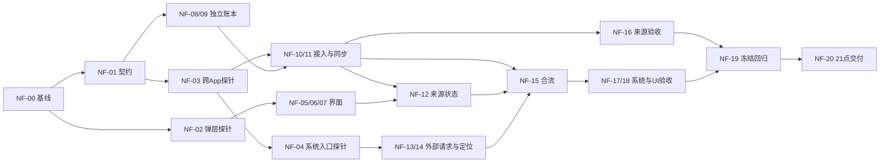

# DailyFlow 10月12日晚—13日21点冲刺路线图

2026-10-12 23:30补充：支持不同IDE中的独立工作副本与文件交接，详见[分工交付约定](agent-prompts/COMMON.md)及其中四份角色prompt。集成负责人先完成NF-00/01统一基线/契约/资源，再由三线独立开发，最后集中集成；角色只交局部证据，NF-12接线与NF-16/17/18最终验收可由I承接，原卡ID和通过门槛不变。完全不提前约定接口的最后合并不推荐。下文49_peer均指实际src/49_experience_peer.splash。

建立：2026-10-12，Asia/Shanghai。排期起点约22:45，内部交付目标2026-10-13 21:00（约22小时15分）；比赛硬截止仍为13日24:00，即14日00:00。**整夜计入可用时间，不设置睡眠空档；18:00冻结功能，保留最后3小时回归与交付。**这是容量计划，不保证所有外部依赖按时解除。

用户已明确取消“账户额度剩余≤15%停止”的规则，历史停止记录保留但不再控制后续任务；实际平台限流仍不能绕过。本次交付是计划与任务账本，没有启动新的功能实现、构建或子Agent。状态只以[唯一账本](execution-state.json)为准。

## 目标与不变边界

目标：保留旧工作台；我的空间弹层、设置及连接授权弹层；以原型为依据的统一经历阅读页；一个独立记账App通过真实授权工具进入确定性同步链；系统Assistant发问后整理并自动拉起/定位DailyFlow经历。独立记账从历史“赛后项”提升为本轮P0最小来源验证App，不扩展完整财务产品。

已验证底座见[最新运行时验收](LATEST_RUNTIME_ACCEPTANCE_20261012.md)：应用内官方Agent结构化回传、有引用关系、取消与来源变化已有证据。实时跨App和系统Assistant自动拉起仍未完成；原型的来源开关和故事分组不是生产能力证明。模拟社媒可以继续使用，必须与真实账本通信分别标记。云账户/同步、真实社媒登录、大图、动画、更多独立App均不进本轮关键路径。

Shell只负责可复用的发现、身份、授权、路由、取消、错误及激活机制；DailyFlow业务、同步和分组留在应用层。保留Hub Cargo.lock、Makepad Windows d3d11修复、个人数据和Provider。新验收必须核实当次全部最新运行时并记录二进制来源；本地兼容补丁和官方发行门槛继续披露，不退回旧版本充作最新。用户授权仍需人处理，取消额度线不等于代点授权。

## 优先级与完成定义

- **P0**：决定目标闭环是否成立、数据/授权是否正确、用户是否可操作，以及可复现交付。NF-03/04为优先级最高的风险探针；P0做不完就必须标记目标未全部完成。
- **P1**：提升阅读与详情质量；允许缩减视觉规格，但基本详情、返回、源变化失效等正确性不得删减。
- **P2**：装饰/媒体/扩展，默认赛后，不以“还有整夜”无限追加。
- not_started→in_progress→passed；失败为blocked，范围裁剪为deferred。诊断卡可通过但 capability=unavailable，后续能力卡仍不得开绿灯。取消/授权失败不盲目重试。

## 并行分工与资源锁

最多4个并发Agent：集成负责人I＋U界面＋S来源账本＋H宿主与系统入口。角色是计划分工，不表示已启动。I负责拆解、契约、集成和证据审核；可在子Agent工作时做独立只读核对。后续接手可以换Agent，不依赖固定会话。

| 工作线 | 可并行内容 | 写入边界 | 不可并行部分 |
| --- | --- | --- | --- |
| U 界面 | NF-02/05/06/07；与账本、入口模块独立开发 | 65_experience_ui及新UI-only模块 | 同一UI文件只允许一个owner；NF-12等待真实来源接口 |
| S 来源 | NF-08/09；随后10/11/16 | 新DailyFlowLedger目录、新来源适配模块 | 真实宿主调用与H错峰；共享catalog由I接线 |
| H 系统入口 | NF-03/04/13/14；与界面/账本实现并行 | 独立探针、新外部请求模块、受控宿主补丁 | 两个宿主探针顺序执行；构建/运行资源独占 |
| I 集成 | 基线、契约、离线审查、测试准备 | 47/49/60共享接线、manifest/tools、构建器、启动器、生成bundle、账本 | NF-15合流、NF-19冻结、NF-20交付按依赖串行 |

共享文件不允许“各改一半”并发写。U/S/H给I准确接线补丁或说明，I先检查diff再合入。`bundle/main.splash`为生成物，不能手改；仅I执行生产构建/stamp。可在隔离副本构建各线，但不能把副本通过算作最终候选通过。

单机16GB：同一时间最多一条Rust编译，复用已经建立的target和缓存；jobs依据实测可用内存设定，禁止多Agent各起cargo。真实宿主/共享Provider验收按锁排队，离线测试可并行；并行Agent不等于并行跑多个Shell。锁记录在唯一账本resource_locks（owner/task/run/process/data_root），交接前释放或给出存活证据。

## 里程碑与整夜排程（北京时间）

| 里程碑/时段 | U 界面 | S 来源 | H 系统入口 | I 与退出门槛 |
| --- | --- | --- | --- | --- |
| M0 12日22:45–13日03:00 | 弹层探针，随后基础导航 | 契约后开始独立账本 | 先跨App、再系统入口探针 | 基线/契约；00:45首轮风险结论，03:00确定真实能力和剩余路径 |
| M1 03:00–06:30 | 空间/设置与统一时间流 | 独立账本可运行；注册与受控读取 | 外部请求上下文与结果落盘 | 06:30至少有真实跨App只读结果；未通立即裁剪非关键工作 |
| M2 06:30–10:30 | 详情，连接授权实际状态 | 进入同步链、更正/删除/去重 | 冷/热启动定位 | 10:30两条高风险链路应各有闭环，不是只有代码 |
| M3 10:30–15:30 | 视觉交互验收 | 来源反例验收 | 系统入口两场景实测 | 合流为同一候选；两故事复用同一实现；15:30决定最终范围 |
| M4 15:30–18:00 | 修阻断与必要交互问题 | 修同步/授权问题 | 修请求/路由/激活问题 | 18:00冻结，不再开新功能；允许提前完成各卡 |
| M5 18:00–21:00 | 协助受影响回归 | 协助受影响回归 | 协助受影响回归 | 冻结候选回归约2h，材料/交付约1h；21点给出通过与未通过清单 |
| 缓冲 21:00–24:00 | 不安排新功能 | 不安排新功能 | 不安排新功能 | 具体发布审核、获准后发布/提交及读回；不自动外发 |

排程是墙钟窗口，不是把每张卡预算相加后的串行估计。运行时漂移、长构建、机器休眠/重启、网络或等待人工授权会消耗窗口；夜间不假定人一直在线。需要确认时集中给出具体入口，继续独立工作，不能把未回复当同意。夜间如需保持机器运行，由用户确保供电及不休眠；本计划不修改系统电源设置。

## 关键依赖与降级规则

图仅概览，精确依赖见任务卡/JSON。NF-03实际可用是NF-10额外门槛；NF-04委派可用是NF-13门槛，自动启动与定位还须NF-14独立验收。

- 00:45/03:00：有可复现通用平台缺陷，最多追加2小时修复调查并由I独占安排增量构建。没有明确路径则记录blocked，继续应用层工作；不得无限耗在宿主。
- 06:30：独立账本可先独立交付；传输不通则连接界面如实未连接。文件导入是备用路线B，不替代跨App完成条件。
- 10:30：系统入口若只有用户点卡片打开，就标部分实现，自动拉起仍未完成；禁止把旧黑板/应用内入口当作系统入口证据。
- 15:30：仍有阻断时，优先保留旧已验证路径、弹层和统一阅读页，再保留已经真实打通的一条新链路。未完成P0显式列出，不宣布“全部做完”。缩减候选的测试范围另记，不篡改完整依赖卡状态。
- 18:00：功能冻结，后续只修影响使用/数据/权限/验收的缺陷；比赛后项留在P2。

## 可接力任务卡

每张卡预算是检查/升级节点，不是保证耗时。路径未标工作区绝对路径时相对DailyFlow。每卡开始读前置证据与版本，接手者只领取依赖满足的一张卡；准确资源锁、owner、运行目录由I维护。

### NF-00 接管、保护基线与当次最新运行时核对

- 优先级/执行线/里程碑：P0 / I / M0。检查预算：0.5小时。
- 前置：无。
- 写入范围：build/overnight-20261013/baseline/；共享账本（仅集成负责人）。
- 执行：检查工作树和真实运行进程；记录生产包、用户数据及保护文件摘要；联网核对 Shell/Hub/Makepad/OctoScript/桥接/内核和参与构建依赖，与现有 runtime-all.json 比较；建立本轮隔离数据与证据目录。
- 完成条件：有版本矩阵、上游核对时间、二进制路径和哈希、本地补丁清单；明确是否需要增量构建；既有生产数据不变。
- 失败/到时：新上游或构建阻断如实记录；不得退回旧版充作最新版；不重复冷构建或 cargo clean。构建单独排队。
- 交接：`build/overnight-20261013/steps/NF-00/<run-id>/handoff.md`、`summary.json`、命令/结果/候选摘要；必须给出下一条准确操作。

### NF-01 冻结三线接口和演示数据身份

- 优先级/执行线/里程碑：P0 / I / M0。检查预算：0.5小时。
- 前置：NF-00。
- 写入范围：docs/NIGHT_SPRINT_CONTRACT.md（待新建）。
- 执行：确定独立账本 app_id/工具名/数据根；复用现有 envelope 的完整来源身份、revision、tombstone、分页；规定外部经历请求、持久化 experience_id、UI定位信号和只读来源状态接口。具体宿主 API 必须由探针确认，拟议名字不得当成现有接口。
- 完成条件：给出版本化接口、错误形状、金额最小单位与币种、请求去重和取消规则；模拟社媒/导入日历/真实独立账本分别标记；三线据同一契约开发。
- 失败/到时：禁止等待最终宿主接口才做所有工作；可用内部适配层，但模拟传输证据不得标为跨 App 实测。
- 交接：`build/overnight-20261013/steps/NF-01/<run-id>/handoff.md`、`summary.json`、命令/结果/候选摘要；必须给出下一条准确操作。

### NF-02 应用内弹层最小探针

- 优先级/执行线/里程碑：P0 / U / M0。检查预算：0.75小时。
- 前置：NF-00。
- 写入范围：experiments/experience-modal/；build/overnight-20261013/steps/NF-02/。
- 执行：使用当前 Splash/Makepad 暴露接口试做遮罩与内容层；验证关闭、输入焦点、滚动、窄屏与背景禁止点击；不先改整页布局。
- 完成条件：真实新宿主中可打开/关闭且背景无误触；记录实际可用 API。Esc 若不受支持须披露并提供可见关闭按钮。
- 失败/到时：到时改用同样保留阅读上下文的侧栏/浮层，明确未达原生 modal 的能力；不修改 Shell 只为视觉动画。
- 交接：`build/overnight-20261013/steps/NF-02/<run-id>/handoff.md`、`summary.json`、命令/结果/候选摘要；必须给出下一条准确操作。

### NF-03 两独立 App 的发现、授权与只读路由探针

- 优先级/执行线/里程碑：P0 / H / M0。检查预算：1.0小时。
- 前置：NF-01。
- 写入范围：experiments/source-bridge/ 的本轮隔离副本；docs/NIGHT_SPRINT_CONTRACT.md（仅提出补充，由 I 合入）。
- 执行：注册两个独立身份与数据根，在当前真实宿主发起一次只读 source tool；核对 caller/owner、允许和拒绝、原样结构化输出；记录是否需要通用 Shell 路由修复。
- 完成条件：有真实请求/回执/工具审计；能判定当前能力 available/unavailable/unknown。探针结论完成不等于传输可用。
- 失败/到时：00:45 首次决策，最多追加一次有明确复现的通用平台修复，预算2小时；不能用 Python 直接读另一个私有数据根伪装成功。
- 交接：`build/overnight-20261013/steps/NF-03/<run-id>/handoff.md`、`summary.json`、命令/结果/候选摘要；必须给出下一条准确操作。

### NF-04 系统 Assistant 委派与应用定位探针

- 优先级/执行线/里程碑：P0 / H / M0。检查预算：1.0小时。
- 前置：NF-03。
- 写入范围：experiments/system-experience-entry/（待新建）。
- 执行：从系统 Assistant 的真实入口启动全新请求，检查工具发现/委派，应用启动或聚焦、参数/路由送达。分别探测冷启动与已有窗口，不把 Ask DailyFlow 当系统助手。
- 完成条件：记录新 request/turn、工具归属及 UI 收到的定位标识；明确支持自动拉起还是只能用户点入口。不得引用 done peer 的旧黑板充作执行。
- 失败/到时：03:00 必须有真实证据或最小阻断。仅能点开卡片则记部分能力，自动拉起仍未完成；继续其他线。
- 交接：`build/overnight-20261013/steps/NF-04/<run-id>/handoff.md`、`summary.json`、命令/结果/候选摘要；必须给出下一条准确操作。

### NF-05 我的空间弹层、设置菜单与旧工作台入口

- 优先级/执行线/里程碑：P0 / U / M1。检查预算：1.5小时。
- 前置：NF-01, NF-02。
- 写入范围：src/65_experience_ui.splash；新 UI 状态模块；60_ui 接线交 I。
- 执行：我的空间改为本机空间弹层；新增独立原有工作台入口；设置改菜单/弹层，不替换经历主内容。来源页先使用真实的已导入状态，给 NF-12 留接口。
- 完成条件：返回仍是原经历/原滚动位置；旧日历账目功能可达；无伪账号登录/云上传；关闭后焦点恢复；宽窄屏可操作。
- 失败/到时：保留可用侧栏作为弹层兼容方案；旧工作台内容不重构或迁移。
- 交接：`build/overnight-20261013/steps/NF-05/<run-id>/handoff.md`、`summary.json`、命令/结果/候选摘要；必须给出下一条准确操作。

### NF-06 统一经历阅读页与有依据的事件分组

- 优先级/执行线/里程碑：P0 / U / M1。检查预算：2.5小时。
- 前置：NF-05。
- 写入范围：src/65_experience_ui.splash；新增 UI-only 展示模块。
- 执行：概括放顶部，来源与更新时间紧随；时间流为主阅读区，候选关系就地核对；仅依据经校验的关系或显式记录分组，同日只能表示日期组。保留已有证据与关系决定语义。
- 完成条件：攀岩和演出两场景同一渲染代码；无预写故事答案；原文/关系/费用三种确认不混淆；数据不足不生成虚构阶段或因果。
- 失败/到时：模型缺少可靠事件分组时按日期显示并明确标签；先保证完整文字体验，不以大图作为通过条件。
- 交接：`build/overnight-20261013/steps/NF-06/<run-id>/handoff.md`、`summary.json`、命令/结果/候选摘要；必须给出下一条准确操作。

### NF-07 详情与就地操作收敛

- 优先级/执行线/里程碑：P1 / U / M2。检查预算：1.5小时。
- 前置：NF-06。
- 写入范围：src/65_experience_ui.splash。
- 执行：宽屏固定详情宽度，窄屏抽屉；显示正文、来源、修订、为什么在这里；将排除/恢复/原始记录操作收进详情；候选关系有两端与证据入口。
- 完成条件：不会因跨来源同 record_id 串详情；源删除/更正/撤权后不显示旧正文或旧确认；没有行内满屏按钮。
- 失败/到时：视觉细节可缩减，删除/撤权失效和可返回必须保留；不以优化为由删掉核验操作。
- 交接：`build/overnight-20261013/steps/NF-07/<run-id>/handoff.md`、`summary.json`、命令/结果/候选摘要；必须给出下一条准确操作。

### NF-08 独立账本数据与事件协议

- 优先级/执行线/里程碑：P0 / S / M1。检查预算：2.0小时。
- 前置：NF-01。
- 写入范围：D:/Life/AgenticApp/DailyFlowLedger/src/；D:/Life/AgenticApp/DailyFlowLedger/tests/（均待新建）。
- 执行：独立应用存储与读写层：新增、同ID更正、删除墓碑、revision、请求幂等；生成兼容 DailyFlow 的 envelope/分页输出；不搬迁旧工作台历史数据。
- 完成条件：金额用整数最小单位+币种；重复请求不重复记账；更正不换ID；删除不复活；与旧工作台及 DailyFlow 数据根隔离。
- 失败/到时：不增加预算/分类系统/统计图/账号；保留最小字段和验证。
- 交接：`build/overnight-20261013/steps/NF-08/<run-id>/handoff.md`、`summary.json`、命令/结果/候选摘要；必须给出下一条准确操作。

### NF-09 独立账本最小界面、bundle 与工具声明

- 优先级/执行线/里程碑：P0 / S / M1。检查预算：1.5小时。
- 前置：NF-08。
- 写入范围：D:/Life/AgenticApp/DailyFlowLedger/bundle/；DailyFlowLedger 构建器、README、LICENSE。
- 执行：做列表和新增/更正/删除入口；声明真实读写风险与所需确认，独立 app_id；根目录 bundle，单独本地注册资料；先用测试数据。
- 完成条件：能单独启动操作与重启读回；工具操作与 UI 同一数据层；bundle check 之外有实际运行证据；不依赖打开 DailyFlow 才能记账。
- 失败/到时：不创建或发布新远程仓库；独立本地目录并不代表已经入库。
- 交接：`build/overnight-20261013/steps/NF-09/<run-id>/handoff.md`、`summary.json`、命令/结果/候选摘要；必须给出下一条准确操作。

### NF-10 双 App 注册与受控传输适配

- 优先级/执行线/里程碑：P0 / S / M1。检查预算：1.5小时。
- 前置：NF-03, NF-09。
- 写入范围：DailyFlowLedger 本地注册材料；DailyFlow/src/ 新独立来源适配模块；共享 catalog/启动器由 I 合入。
- 执行：在已验证的路由上注册真实账本，按授权只读拉取；验证非授权caller不可访问；来源输出由程序解析，不让模型转抄账单作为传输。
- 完成条件：当前真实宿主两 App 通信，caller/owner/记录身份可审计；拒绝授权不访问数据；网络/工具不可用有明确状态。
- 失败/到时：仅当 NF-03 传输能力 available 才可实施并通过；否则 blocked，离线导入只能单列备用演示。
- 交接：`build/overnight-20261013/steps/NF-10/<run-id>/handoff.md`、`summary.json`、命令/结果/候选摘要；必须给出下一条准确操作。

### NF-11 工具结果进入确定性同步链

- 优先级/执行线/里程碑：P0 / S / M2。检查预算：2.0小时。
- 前置：NF-10。
- 写入范围：DailyFlow/src/ 新来源同步模块；DailyFlow/tools/ 新跨App测试；47_experience 接线交 I。
- 执行：将结构化结果送入现有身份/修订/墓碑/排除校验；保留同步游标和失败原子性；更正更新原项，重复拉取不增量计费；撤权使展示/上下文立即不可用。
- 完成条件：真实工具更正/删除/重复页/空页进入生产投影并读回；跨来源同ID隔离；既有本地排除仍有效；零反向写账本。
- 失败/到时：路由成功但未落入同步链不得标记接入完成；单页限制如存在必须显式返回截断。
- 交接：`build/overnight-20261013/steps/NF-11/<run-id>/handoff.md`、`summary.json`、命令/结果/候选摘要；必须给出下一条准确操作。

### NF-12 连接与授权弹层接入真实状态

- 优先级/执行线/里程碑：P0 / U / M2。检查预算：1.0小时。
- 前置：NF-05, NF-11。
- 写入范围：src/65_experience_ui.splash；来源状态查询接口由 S 提供。
- 执行：设置中的来源卡显示文件导入/独立App、可用/未授权/已授权/失败、最少范围、同步时间和错误；读取范围开关与宿主授权分别表达；读取动作走真实适配器。
- 完成条件：不能通过勾选本地开关冒充宿主授权；取消/拒绝不自动重试；不伪造社媒账号连接；状态在重启和撤权后正确。
- 失败/到时：来源传输阻断时 UI 可交付真实未连接状态，但本卡的真实接入验收仍 blocked，不标全过。
- 交接：`build/overnight-20261013/steps/NF-12/<run-id>/handoff.md`、`summary.json`、命令/结果/候选摘要；必须给出下一条准确操作。

### NF-13 外部经历请求与结果持久化入口

- 优先级/执行线/里程碑：P0 / H / M1。检查预算：2.0小时。
- 前置：NF-01, NF-04。
- 写入范围：DailyFlow/src/ 新外部请求适配模块；49_peer 公共接线由 I 合入。
- 执行：为系统入口建立独立请求上下文并复用已校验的官方执行链；绑定 request/turn/experience，保存完成结果和错误；重入去重，取消和超时拒收迟到结果。
- 完成条件：无需预先在 DailyFlow 输入框创建任务也能执行；结果为带来源的结构化对象；不同请求不覆盖；未完成工具链不算完成经历。
- 失败/到时：只有 NF-04 委派路径真实可用才通过；不能绕过现有校验以适配外部调用。
- 交接：`build/overnight-20261013/steps/NF-13/<run-id>/handoff.md`、`summary.json`、命令/结果/候选摘要；必须给出下一条准确操作。

### NF-14 自动打开与指定经历定位

- 优先级/执行线/里程碑：P0 / H / M2。检查预算：2.0小时。
- 前置：NF-13。
- 写入范围：外部请求适配模块；启动/激活接线由 I 合入；共享宿主修复仅 H 提交补丁。
- 执行：持久化后通过已验证宿主入口启动/聚焦 DailyFlow 并选择 experience_id；冷启动读取待打开标识，热窗口更新；未知/被删除ID显示诚实状态。
- 完成条件：系统 Assistant 全新问题后自动显示本次经历，冷/热各通过一次；无手动点 DailyFlow 输入框补发，无旧黑板/旧截图代替；没有支持就不声称完成。
- 失败/到时：只能返回打开链接/速览卡需标为降级；仍不能冒充自动拉起。不要用全局文件轮询绕过宿主身份和授权。
- 交接：`build/overnight-20261013/steps/NF-14/<run-id>/handoff.md`、`summary.json`、命令/结果/候选摘要；必须给出下一条准确操作。

### NF-15 三线合流与唯一候选包

- 优先级/执行线/里程碑：P0 / I / M3。检查预算：1.5小时。
- 前置：NF-06, NF-07, NF-11, NF-12, NF-14。
- 写入范围：src/47_experience.splash；src/49_peer.splash；src/60_ui.splash；tools/build_event_app.py；bundle 生成产物、manifest/tools、catalog/启动器。
- 执行：按已冻结契约串接三线；只由 I 生成/stamp生产候选，保存每次合入差异；运行受影响的契约和准入检查；锁定候选源码与运行时摘要。
- 完成条件：源工具→同步→官方整理→统一UI为同一候选；旧工作台入口未退化；能力说明符合真实路径。
- 失败/到时：依赖被裁剪时记录未完成卡和缩减候选的单独验收范围；不得强行把依赖改passed。
- 交接：`build/overnight-20261013/steps/NF-15/<run-id>/handoff.md`、`summary.json`、命令/结果/候选摘要；必须给出下一条准确操作。

### NF-16 独立来源更正、删除、拒绝及重启验收

- 优先级/执行线/里程碑：P0 / S / M3。检查预算：1.25小时。
- 前置：NF-11。
- 写入范围：build/overnight-20261013/steps/NF-16/；独立来源回归脚本。
- 执行：新测试根中，真实账本记220元→拉取→改200元→再拉取两次→删除→重启；检查用户排除、同号跨源、拒绝/撤权与失败保留；所有源变动用真实业务入口。
- 完成条件：更正保留ID且不重复计费；删除不复活；撤权正文/金额不可见；凭据和真实用户数据不变；审计确认 DailyFlow 只读来源。
- 失败/到时：模型或传输注入测试只能补充，不能替代真实跨 App 验收。
- 交接：`build/overnight-20261013/steps/NF-16/<run-id>/handoff.md`、`summary.json`、命令/结果/候选摘要；必须给出下一条准确操作。

### NF-17 系统入口到经历的真实端到端验收

- 优先级/执行线/里程碑：P0 / H / M3。检查预算：1.5小时。
- 前置：NF-15。
- 写入范围：build/overnight-20261013/steps/NF-17/；系统入口回归脚本。
- 执行：攀岩冷启动、演出热窗口两个问题，从系统 Assistant 开始；核对独立账本新数据、结构化回传、新turn、展开正确经历；测取消/拒绝/重复请求及完成peer新任务。
- 完成条件：保存完整输入→工具审计→同步→结果→UI证据与相同候选摘要；旧业务无非预期写入；不能只用 in-app official 测试替代。
- 失败/到时：授权等待人操作时释放宿主测试锁并继续离线工作；无答复绝不视为批准；未过项保留失败记录。
- 交接：`build/overnight-20261013/steps/NF-17/<run-id>/handoff.md`、`summary.json`、命令/结果/候选摘要；必须给出下一条准确操作。

### NF-18 原型对照视觉与交互验收

- 优先级/执行线/里程碑：P0 / U / M3。检查预算：1.0小时。
- 前置：NF-15。
- 写入范围：build/overnight-20261013/steps/NF-18/；docs/NIGHT_SPRINT_VISUAL_REVIEW.md（待新建）。
- 执行：同场景对照 experience-v2 原型与生产截图；1280/412宽检查空间、设置、来源、统一时间流、详情、旧工作台、滚动/焦点/遮罩；视需要请求用户协助真实GUI。
- 完成条件：逐项列符合/偏差/理由；无截断或点穿；来源/模拟标识可见；截图必须实际打开查看，hub check和控件树不代替视觉验收。
- 失败/到时：优先修无法操作与误导状态；仅装饰性间距差异可留P2，明确不保证像素级复刻。
- 交接：`build/overnight-20261013/steps/NF-18/<run-id>/handoff.md`、`summary.json`、命令/结果/候选摘要；必须给出下一条准确操作。

### NF-19 18点冻结与关键回归

- 优先级/执行线/里程碑：P0 / I / M4。检查预算：2.0小时。
- 前置：NF-16, NF-17, NF-18。
- 写入范围：build/overnight-20261013/final/；唯一任务账本/验收报告。
- 执行：冻结功能；重核上游与运行二进制，如有新版本按最新规则处理，不静默忽略；对冻结候选运行旧业务保存/更正/重启、经验/peer/关系、拒绝与取消等受影响测试；修复后只补相关回归。
- 完成条件：无阻断缺陷；每份报告有正确源码/包/运行时摘要；新版本导致的未测项明确；旧工作台与保护文件保持，失败日志不覆盖。
- 失败/到时：18点后只修P0/P1；不能完成全范围就交付诚实缩减候选及未完成清单，不挤占最后全部缓冲。
- 交接：`build/overnight-20261013/steps/NF-19/<run-id>/handoff.md`、`summary.json`、命令/结果/候选摘要；必须给出下一条准确操作。

### NF-20 21点交付材料与发布候选

- 优先级/执行线/里程碑：P0 / I / M5。检查预算：1.0小时。
- 前置：NF-19。
- 写入范围：docs/ 实际验收与限制；listing/README/PRIVACY 的实际变化；新独立发布候选目录。
- 执行：刷新 DailyFlow 与独立账本启动说明、许可证、包摘要、截图、权限披露和竞赛证据映射；替换草稿中的过时能力声明；输出待审核的具体发布材料，与旧 DF-21/22/25 衔接。
- 完成条件：21:00前可运行候选、可复现步骤、证据索引、限制和待发布动作齐备；旧ZIP仍归档；本地验收与官方发行包兼容性不混淆。
- 失败/到时：发布/推送/tag/提交仍遵照具体外发授权，不因取消额度线自动执行；21–24点是审核/发布/回读缓冲，不新增功能。
- 交接：`build/overnight-20261013/steps/NF-20/<run-id>/handoff.md`、`summary.json`、命令/结果/候选摘要；必须给出下一条准确操作。

### NF-21 装饰细节与扩展媒体

- 优先级/执行线/里程碑：P2 / U / POST。检查预算：2.0小时。
- 前置：NF-20。
- 写入范围：未来 UI/媒体模块。
- 执行：大图、动画、复杂无障碍补全仅在正式范围之后安排；账号/云同步、完整记账统计、更多独立来源另开赛后里程碑。
- 完成条件：不得减少核心验收时间；媒体授权、加载失败、资源身份另有真实证据。
- 失败/到时：默认赛后，不计入21点承诺。
- 交接：`build/overnight-20261013/steps/NF-21/<run-id>/handoff.md`、`summary.json`、命令/结果/候选摘要；必须给出下一条准确操作。

## 交接、验收与追溯

使用[步骤交接模板](STEP_HANDOFF_TEMPLATE.md)，本轮证据根改为 `build/overnight-20261013/steps/NF-xx/<run-id>/`。记录：修改文件、真实执行命令、输入/运行时/包哈希、静态或注入或真实宿主测试性质、失败原文、未尝试的下一步、进程与数据根。不能仅写“继续调试”。每次有意义进展更新根agent.md，由I串行合入共享账本。

原卡DF/UX对象和证据不改写；计划前完整快照与[哈希](history/pre-overnight-20261012/hashes.json)保留。NF卡是新里程碑，与UX-09实时接入、DF-02/03探针有继承关系，不能回填旧卡冒充新运行。状态仍只有execution-state.json一个来源；多Agent期间active_task保留I的当前卡，active_tasks记录所有已领取NF卡与owner，均由I维护。

关键旧测试入口包括 `test_experience_contracts.py`、`test_experience_peer_contracts.py`、`test_experience_reasoning.py`、`test_experience_official.py`、`test_experience_no_consent.py`、`test_experience_relations_ui.py`、`test_business_flow_newhost.py`、`test_timeline_resync_ui.py`。先读脚本帮助/最新运行时报告中的参数，使用本轮manifest及全新输出目录；不得硬编码历史exe或污染canonical样本。新系统入口/跨App验收需要新增真实测试，不能只运行旧套件。

首次新授权由用户操作；优先使用已合法授权的隔离环境，拒绝分支使用新隔离环境。禁止复制授权文件、自动批准、打印凭据。最少computer-use，需人的界面操作时给出准确窗口/入口；自动协议测试与截图对照不能隐瞒未经人工或真实UI验证的部分。

最终报告把证据映射到比赛四维：需求价值（跨来源经历）、核心流程（官方入口到展开）、数据与失败（权限/更正/删除/取消）、复现材料（固定候选、许可证、启动及截图）。不预承诺涨分或获奖。21点交付可审核的候选；发布材料对应本次摘要，公开行为继续沿用DF-22/25审核要求。
