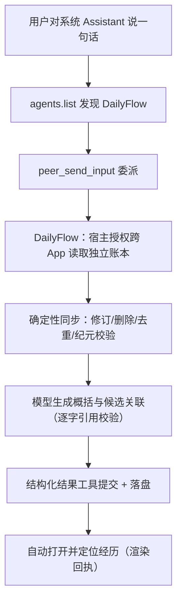

# Submit DailyFlow 0.2.0 — 跨 App 个人经历时间流（复赛提交）

本版为 DailyFlow v0.1.0（[#113](https://github.com/OctoSense-org/OctoSense-App-Hub/issues/113)，初评入围 75/100）之后的迭代版本，关联原申请 #113；如需沿用原申请归并评审，请维护者处理。按 #113 评审意见，本版改用 GitHub 发布流程（tag + Release）并提高版本号。

> 提交前请核对"待用户填写"标记的三处；正文其余部分可直接粘贴。

## 对 #113 初评建议的回应

| 初评建议 | 本版状态 |
| --- | --- |
| 1. 补 Apache-2.0 LICENSE 文件 | ✅ 已补（仓库根 LICENSE，与 listing 声明一致） |
| 2. dailyflow.* 工具在官方宿主的执行验收 | ✅ 已完成并超出建议范围：真实系统 Assistant 全链路（发现→委派→跨 App 读取→整理→自动定位）两端到端 20/20 通过，含原生工具审计回执（见验收证据表） |
| 3. src→build_event_app.py 模块对应文档 | ✅ 已在仓库（构建脚本内置模块清单与模块边界断言；docs/AGENT_EXECUTION_ARCHITECTURE.md 有完整映射） |
| 下一步：GitHub 发布流程并提高版本号 | ✅ 本版 v0.2.0，tag + Release（见提交信息） |

## DailyFlow：把散落的记录，串成可信的经历

生活中的一件事，常常散落在几个地方：支出在账本里，安排在日历里，灵感在社媒里。过一阵子想知道"我的攀岩经历了什么、花了多少钱"，没有一个应用能回答——数据是孤岛。

**DailyFlow 是一个个人经历时间流应用**：围绕一段经历（一次攀岩、一场演出），把多个来源的记录组织成一条可追溯的时间流。它由两个真正独立的 App 组成——主应用 DailyFlow 与独立记账应用 DailyFlow Ledger，跨 App 数据读取经由宿主授权完成：你授权，它才能读；撤回授权，内容立即隐藏。

这个版本的核心变化：**从"同一包内的三个模块"进化为"两个独立 App 的真实跨 App 协作"**，并且整条链路由系统 Assistant 驱动——你只说一句话，系统助手发现并委派 DailyFlow，它读取独立账本、确定性同步新数据、由模型生成带原文引用的概括与候选关联，保存后自动打开并定位到这段经历。

## 提交信息

- 发布者：毛茸茸战队（`kumayuripool`）
- 公开仓库：https://github.com/KumaYuriPool/DailyFlow
- **【待用户填写】版本标签与 commit SHA**
- **【待用户填写】视频链接**（建议放最前）
- 平台：Windows
- 运行环境说明：见下方"运行环境与上游贡献"

## 新版本可以做什么（相对 0.1.0）

| 能力 | 0.1.0 | 0.2.0 |
| --- | --- | --- |
| 应用形态 | 单包三模块 | **两个独立 App，宿主授权跨 App 读取** |
| 入口 | 应用内对话 | **系统 Assistant 一句话委派**（agents.list 发现 → peer 委派 → 异步整理 → 自动定位） |
| 数据来源 | 应用内模块 | 独立账本 App（真实同步）+ 导入样本（显式标注） |
| 整理结果 | Flow 时间线 | 经历目录 + 统一时间流 + 带原文引用的概括 + 候选关联（逐条可核对/排除/恢复） |
| 来源治理 | 无 | 连接/授权/读取范围三行分示；范围开关；撤权即隐藏；修订与删除全程可追溯 |

一段真实链路（全部有原生审计回执）：用户对系统 Assistant 说"整理我的攀岩经历"→ `agents.list` 发现 DailyFlow → `peer_send_input` 委派 → DailyFlow 调 `dailyflowledger.read_events` 跨 App 读取（宿主校验双方准入、授权、身份，返回绑定对象）→ 确定性同步（更正保留原 ID、删除不复活、重复拉取幂等）→ 模型生成概括与候选关联（逐字引用校验，引用不符即拒绝）→ 结构化结果工具提交 → 经历落盘 → **自动打开并定位**（渲染回执确认）。

## 可信优先：模型只理解和概括，程序处理一切事实

- **逐字引用校验**：模型概括的每条证据必须逐字复制来源原文（中文冒号/逗号都不许改），不符即拒——真实测试中模型两次格式错误提交均被拒绝并自我修正。
- **确定性同步**：金额更正 220→200 同 ID 不重复计费；删除后墓碑不复活；翻页跨授权纪元判 REVOKED；迟到结果丢弃。
- **结构化只读**：跨 App 读取经宿主 `app_tools` 读桥，写工具被宿主结构化拒绝（READ_ONLY_REQUIRED），错主调用被拒（NOT_GRANTED），撤权后正文/金额完全不可见。
- **诚实标注**：导入样本明确"无需宿主授权"，不冒充已授权连接；授权状态永远来自宿主实时核验，不读磁盘文件充当权限。

## 核心链路

## 运行环境与上游贡献（诚实披露）

跨 App 能力依赖我们为 OctoSense 平台新增的 `app_tools` 安全读桥（只读保证、双方授权校验、身份绑定、授权纪元、撤权感知）。围绕它：

- **已提交官方的 Shell 缺陷修复 PR ×2**：宿主服务注册竞态、turn.start 超时（等待评审）
- **已备好的 PR 材料**：跨 App 读桥（8 文件，三次 cargo check + 测试通过）、App Hub 合约配套（已知能力清单 + 工具命名空间连字符修复）、card-host 首卡修复
- 因此我们的 manifest 声明 `requires: cross-app-read-v1`——**在这些 PR 合并、官方发布新版本之前，官方 App Hub 的包校验会拒绝该声明**；跨 App 功能当前在我们的本地修补运行时上运行（Shell/Kernel/card-host/hub 四组件 SHA256 锁定，全部验收在此组合完成），**本组合不是官方发行包**。
- 官方发行门槛（native-apps 标签规则、setup 固定 pin）未通过，如实披露。

## 验收证据（全部真实运行，非注入替代）

| 场景 | 结果 |
| --- | --- |
| 系统 Assistant 冷启动端到端（攀岩） | 20/20 检查通过（原生审计：2×experience_context + 2×experience_result + 状态查询 + 渲染回执） |
| 系统 Assistant 热窗口（音乐会，已完成 peer 接新任务） | 20/20 通过 |
| 跨 App 真实拉取/更正/重复/删除/重启 | 全过（同 ID 更正 220→200、删除不复活、幂等） |
| 真实撤权（来源 App 卸载，宿主 live 复查） | 记录全部隐藏、来源标记 revoked |
| 宽屏 UI / 窄屏 / 旧工作台 / 设置 / 范围开关 | 41 + 窄屏 + 8/8 全过 |
| 视觉对照 | 18 张截图逐张评审 + 集成候选全套断言 |

## 双 App 架构：为什么是两个独立应用

DailyFlow 0.2.0 由两个独立安装、独立授权、独立存储的应用组成：

| 应用 | 职责 | 数据 |
| --- | --- | --- |
| **DailyFlow**（主应用） | 经历时间流、模型整理、候选关联、来源治理 | 只存经历组织结果与引用，**不持有来源原始数据** |
| **DailyFlow Ledger**（独立记账） | 专业的支出记录：记一笔、更正、删除 | 权威账目数据，主应用只能经宿主授权只读 |

分开不是架构装饰：只有账本 App 持有账目，主应用对它的每一次读取都经宿主校验（双方准入、授权、身份绑定），用户撤权后主应用立即失去全部内容——**"数据的权威永远在来源 App 手里"**。这是对 0.1.0"同包三模块"的根本升级：来源 App 与整理 App 的边界，就是未来接入任意第三方 App 的边界。

**单 App 也能用**：未安装 Ledger 时，主应用的导入样本、示例经历、应用内助手、旧工作台全部正常，仅"账本来源"为空（设置中如实显示"连接：状态未知"）；对方 App 被卸载等价于撤权场景，内容隐藏、不崩溃。跨 App 是增量能力，不是运行依赖。

> Ledger 与主应用同仓库发布（`DailyFlowLedger/` 目录）、随主应用在本申请中一同验收；如维护者要求 Ledger 单独申请，可随时从同一仓库单独提交。

## 旧工作台：完整保留，数据同源

侧栏"工作台"进入 0.1.0 的原有界面（对话/日历/账本/数据），功能原样保留、8/8 真实点击回归通过；它记的账与经历时间流读取的是同一份本地数据，无迁移成本。新 UI（经历时间流）是默认入口，旧工作台继续作为快速记录与日历入口。

## 隐私与数据

- 全部数据保存在本机；无账号、无云端。助手整理可能将所选内容发送给模型服务（弹层明示）。
- 演示数据为合成样本，明确标注"导入样本/合成"；不读取用户任何真实个人数据。
- 隐私文档：**【待用户填写：指向仓库 PRIVACY.md 的更新链接】**

## 下一步

上游 PR 合并后：App Hub 正式发布（双 App）、真实社媒来源接入、自动 resize、Esc 关闭与装饰细节（P2）。
