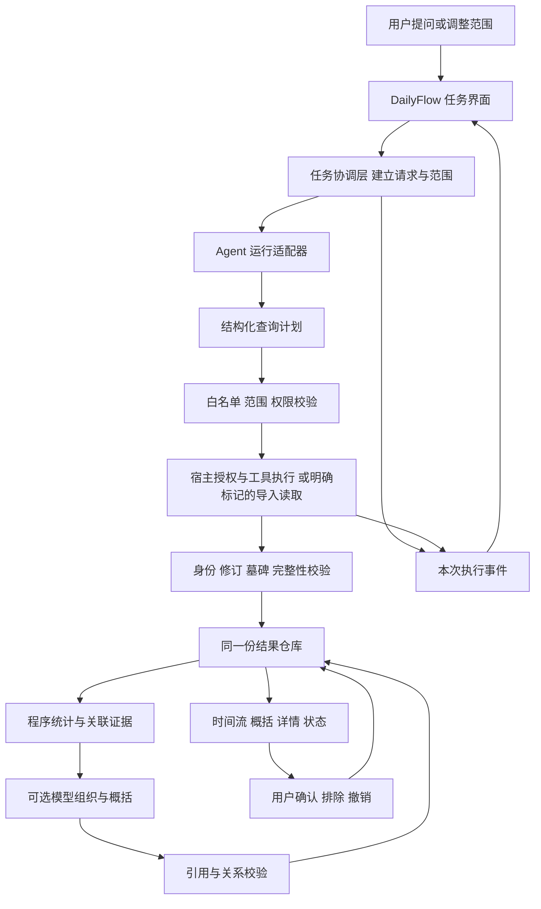

# DailyFlow 经历界面与 Agent 交互设计

更新于 2026 年 10 月 11 日。设计基准为[第二版可交互原型](../prototypes/experience-v2/index.html)。面向产品、UI 和接入实现，本文规定目标交互，不代表生产功能已完成。

DailyFlow 的主界面围绕一段经历展开。Agent 理解用户要整理什么，提出必要来源与候选关系；工具读取记录，程序核对身份、修订和金额；用户在时间流中核验和纠正。Agent 的执行过程通过任务状态、候选关联和引用进入 UI，结果保留为可操作的数据，而不是只有一段聊天回答。

## 一 设计范围与实现基线

| 层次 | 当前可依据的事实 | 本设计要求补齐的能力 |
| --- | --- | --- |
| HTML 原型 | 本地规则、内置三故事、演示进度、localStorage，未连接模型 | 作为布局与操作参考；所有模拟状态需换成真实任务事件 |
| 应用内模型 | 50_agent 的 model.complete 返回受约束意图；timeline_topic 可选择已导入主题 | 返回主题、范围、必要来源的计划；查询后提出有引用的关系与概括 |
| 官方应用 Agent | dailyflow.* 工具桥接与既有核心读写有历史证据 | 应用内发起、取消、任务关联、结果回到当前 UI，须单独探针与验收 |
| 来源与时间流 | 同包查询和文件导入、同步脚本已有实现；近期修复报告与独立验收需按版本对应 | 接入统一结果仓库，支持本次请求读回、来源状态和详情失效 |
| 视觉与资料 | 原型图使用合成照片和模拟社媒 | 生产渲染器的图文、滚动、键盘焦点与窄屏逐项验证 |

HTML 可以作为浏览器交互原型，不能假定整页 HTML/CSS 能直接放进当前 Splash 宿主。界面组件需映射到实际渲染器；没有图片能力时保留同样的文字信息与操作结构。

本文取代旧交互矩阵中的目标导航和 Agent 展示方式，保留既有业务及验收记录。后续开发不得把旧主体 Flow 的 ID 直接当成新“经历”ID。

## 二 信息架构

左侧只有经历目录：搜索、新建、最近经历。底部为“我的空间”和“设置”。设置内包含“连接与授权”“文件导入”“备份与同步”；云端仍是规划入口，首版无需登录，不上传数据。

中央是当前经历：标题、时间范围、来源摘要、简短概括、更新提示、事件组及自然语言输入框。右侧按需打开“记录详情”。当前经历顶部的来源标签只说明本次使用范围；全局连接与授权在设置管理。标签移出本次范围不等于撤销全局权限，操作必须区分。

无经历时，中央显示“想把哪段经历串起来？”及两个示例问题。已有记录、账本、日历与经期功能保留在“我的空间 → 本地记录”中，保持可达，不迁移或删除数据；经期不默认进入经历检索。

搜索目录仅匹配已保存的经历名称，不隐式启动 Agent 或搜索所有私人源记录。“新建经历”打开自然语言输入面板；“空白创建”作为次要选项。

临时提问先产生“本次回顾”，用户点击“保存为经历”后进入目录。主动点击“新建经历”表示创建本地经历容器，查询失败也保留草稿。两者都不自动开启持续监控或创建来源记录。

## 三 Agent 在界面中的入口

| 入口 | 用户目的 | Agent 参与方式 | 界面结果 |
| --- | --- | --- | --- |
| 新建经历的输入框 | “我是怎么开始攀岩的？” | 理解主题、时间与所需来源；必要时澄清 | 新经历草稿或临时回顾 |
| 当前经历底部输入框 | “只看九月”“实际花了多少？” | 继承当前范围，明确区分过滤、汇总与修改意图 | 更新范围、显示答案与引用，保留返回原范围 |
| 事件卡的“待确认” | 判断可能相关的记录 | 展示模型候选及其证据 | 用户确认、排除或保留未决 |
| 记录详情的“为什么出现在这里” | 理解关联依据 | 显示简短理由及引用，不展示内部思考链 | 定位支撑关系的记录 |
| “更新来源” | 读取最新状态 | 先确定性同步；数据确有变化时才视需要重新整理 | 新增、更正、移除、失败与受影响概括 |
| “整理过程” | 核验本次执行 | 展示实际工具事件和来源状态 | 可折叠任务记录，可取消 |

打开详情、确认已展示的候选、排除、撤销、切换经历、显示已缓存数据，均可由程序直接执行，不额外发模型请求。用户用自然语言表达这些动作时，Agent 只负责解析目标；有歧义必须先定位。

“更新来源”不能为了展示 Agent 而无条件再次调用模型。无变化时直接显示“已是最新”；只有新的主题问题、证据变化或新候选才需要整理。

## 四 主任务的完整交互

以“帮我看看，攀岩是怎么逐渐进入我的生活的”为例，以下记录数仅是设计举例，实际 UI 必须使用工具回执中的值。

| 步骤 | 用户所见与操作 | 执行约束 |
| --- | --- | --- |
| 1 提交 | 问题转为顶部任务提示，输入保留；显示“正在理解这次回顾”与取消 | 生成新 request_id，绑定当前经历和查询版本 |
| 2 定范围 | “准备查看 9月1日至10月10日的社媒、日历与账目”，可调整 | 日期来自问题或可见默认范围；关键歧义以问题卡澄清，不能随意扩大范围 |
| 3 授权 | 仅在需要新权限时显示来源及读取范围，调用真实宿主授权 | 现有授权内读取不重复加确认；拒绝后可继续其他来源，不自动重试被拒来源 |
| 4 读取 | 分来源显示“日历已读取 3 条”“账目读取中” | 每条进度对应真实执行事件；不伪造百分比 |
| 5 整理 | 先展示已核验事实，标为“仍在整理”；出现有依据的候选事件组 | 部分数据不得标成完整回顾；源内容只作资料 |
| 6 呈现 | 概括＋事件组＋引用；不确定关系显示“待确认” | 概括必须引用记录；金额由程序统计；没有证据不编造频率或因果 |
| 7 纠正 | 在卡片旁确认或移除具体关系，可立即撤销 | 只写 DailyFlow 关联决定；不写来源 App |
| 8 保存 | 临时回顾提供“保存为经历”；新建草稿保存当前结果 | 保存问题、范围、关系与引用，刷新不重置已明确的用户决定 |

范围不清时优先沿用当前经历的可见日期范围。例如“这次演出”匹配到两场时，问题卡显示两场名称、日期与可用依据供选择。用户离开或取消时保留输入，不把未回答的候选默认为选中。

## 五 时间流中的事实与模型建议

事件组包含一个可编辑的展示标题、时间范围和若干来源记录。模型可以建议“第一次走进岩馆”这样的标题，原始日程、原文和金额保持原样。界面在必要处标明“整理标题”，不能让模型改写的句子看起来像社媒原文。

关系状态分为“待确认”“已确认”“已排除”“已失效”。其中“已确认”必须来自用户决定或源中可核验的明确关联；同一天、相似文字只支撑候选。不要展示无校准依据的“可信度 95%”。

| 操作 | 改动范围 | 保存与撤销 |
| --- | --- | --- |
| 确认相关 | 指定事件与指定记录之间的候选边 | 保存引用的源身份、修订及确认方式；支持撤销 |
| 不相关 | 先列出该组记录，让用户明确移除哪条关系 | 不默认移除整组或第一条记录 |
| 从这段经历中移除 | 指定记录对当前经历的成员关系 | 仅本经历生效，原始数据保留；已排除列表可恢复 |
| 调整日期范围 | 本次查询及可见结果 | 不删来源记录；范围外记录不算删除 |
| 修改原记录 | 回到有能力且已授权的来源编辑流程 | 首版默认回源，不在关联按钮后偷偷写源 |

关联确认和记录成员排除是两个不同概念。排除 A 与 B 的候选关系，不必把 B 从整段经历隐藏；界面文案和存储必须明确区分。

统计只取符合当前日期、状态和关联口径的权威账目。候选费用单独显示“待确认费用 ¥X”，不混入已确认合计；社媒中提到的金额不重复记账。同一笔费用关联多个事件只计一次，不同币种分别显示，未知金额不算作零元。

## 六 记录详情及变化反馈

详情标题为“记录详情”，副标题为“来自模拟社媒 · 9月13日”或真实来源名称。原文、图片、时间、金额在上；“为什么出现在这里”及确认状态在下；原始 ID、修订、读取时间收进“来源信息”。只有真实可达且有权限时才显示“查看原始记录”链接。

点击记录只展开侧栏，不改变时间流滚动位置。桌面关闭详情回到原选中卡；窄屏详情作为独立层，顶部必须有返回。键盘可关闭并把焦点还给触发记录；撤销提示同时保留可长期访问的“已排除记录”入口。

| 来源变化 | 详情和时间流的处理 |
| --- | --- |
| 更正金额或标题 | 同一身份更新，显示新修订；观察到旧值时才展示前后对照 |
| 明确删除 | 开着的详情立即显示“这条记录已从来源移除”，停止显示旧正文/图片/金额；统计与关联同步失效 |
| 无读取权限 | 显示“当前无法访问此记录”；隐藏关联内容及模型上下文，提供合法的重新授权入口 |
| 网络失败 | 显示上次读取时间与“本次未更新”；不能把失败变成删除或零条 |
| 媒体失败 | 显示配文及图片占位，不阻塞详情和返回 |

更新栏为真实 diff：“新增 2 条 · 更正 1 条 · 移除 1 条”。已确认关系若依赖字段发生实质改变，标为“需要重新核对”，不静默覆盖用户选择；普通排除保持，用户可主动恢复。源删除是失效，不能用“恢复排除”复活源记录。

## 七 任务状态与错误体验

每个经历同一时间只允许一个前台整理任务。其他经历可以有独立任务；首版若不支持并发，明确提示用户先取消或等待，不能把多个任务混在一条全局状态中。

| 状态 | 界面文案示例 | 允许的操作 |
| --- | --- | --- |
| idle | 想回看这段经历的什么？ | 提问、直接浏览 |
| interpreting | 正在理解问题 | 取消 |
| needs_clarification | 你指的是哪场演出？ | 选择、补充、取消 |
| needs_permission | 需要读取所选日期的日历 | 宿主授权、跳过、取消 |
| fetching | 已读取社媒；日历读取中 | 取消，查看来源状态 |
| organizing | 正在整理关联 | 取消，浏览标注为未完成的事实 |
| partial | 日历未能更新；其余来源已完成 | 仅重试失败项，调整范围 |
| ready | 回顾已更新，有 2 处待确认 | 核验、纠正、保存 |
| failed | 本次整理未完成，之前的回顾仍保留 | 重试、手动浏览、查看原因 |
| cancelled | 已停止本次整理 | 改写问题、重新发起 |

计时不驱动完成状态。显示“3 个来源中已完成 2 个”需要确有对应完成事件。记录数来自校验后的结果；分页未结束须显示覆盖不完整。无结果只在成功且范围完整时展示“所选范围内没有找到记录”。

取消会停止后续调度并请求取消当前模型/工具。UI立即终止本次展示更新；如果宿主不能物理中止，标明“已停止展示，后台调用仍在结束”，迟到结果必须丢弃。不能把取消写操作声称为已回滚；来源写入结果未知时先按原request_id读回核验。

Agent 不可用时仍可浏览最近合法缓存、查看来源、手动过滤和管理关系；提示“助手暂不可用”，不播放模拟智能进度。来源授权撤销后的旧缓存不得继续显示或发送模型。

## 八 Agent 接入结构



UI 不解析 Agent 自由文本来修改记录，也不允许模型返回任意 HTML、脚本、文件路径或新的工具名。所有输出通过固定 schema 校验后更新结果仓库。时间流、金额、详情和摘要引用从同一结果版本读取。

### 两种模型入口共用一套任务结果

**近期路径：应用内 model.complete。** 复用 src/50_agent.splash，由宿主配置的 Provider 执行模型请求。第一阶段返回计划，DailyFlow 校验后调用实际已注册的读取能力；第二阶段可把最小必要的已授权记录交给模型生成候选和概括。两次模型调用分别计为计划和组织，失败互不伪装成功。程序查询或统计已经足够时不追加第二次调用。

**官方路径：应用 Agent。** 顶部 Ask DailyFlow 已有工具入口不等于底部输入框已能调用 peer。必须验证官方运行接口是否能创建本次应用任务、传递范围、接收事件、取消、关联最终结果。若 peer 已 done，依宿主支持方式创建或重新发起任务，不向 done peer 继续 peer_send_input，不读取旧黑板冒充新结果。

官方路径通过后，接到同一个任务协调层、来源仓库和结果契约。切换运行入口不应改变用户的确认/排除与证据要求。模型Provider配置入口属于宿主；DailyFlow可引导到宿主设置，但不在经历页面索取API密钥。

**系统助手委派是附加入口。** 委派请求仍生成本次关联标识，返回新鲜结果引用；不能因为应用内模型成功就称系统Agent委派成功。比赛主流程应能在DailyFlow内完成。

### 文件导入路线的接入要求

来源目录必须披露 source_mode 为 internal、import 或 app_tool。导入可以被Agent查询，但界面显示“读取已导入记录”，不能显示“已连接社媒”。尚未验证跨App通信时不承诺真实拉取。

现有 tools/sync_timeline_import.py 是命令行链路，不能假设 UI 能直接启动任意进程。首版可在“文件导入”使用宿主提供的受限选择/读取接口；若宿主接口不可用，提供明确导入说明并保留“重新读取已导入数据”的动作。需要自动同步时，另行实现白名单同步服务或受控工具入口并验收，不能把脚本存在当作按钮已经接通。

## 九 结构化请求与 UI 事件契约

以下名称是拟议的应用内部类型，不是已存在的 OctoSense API 或对外工具。

| 类型 | 最低字段 | 校验重点 |
| --- | --- | --- |
| ExperienceRequest | request_id、experience_id或临时session_id、query_revision、问题、时区、显示范围、授权版本 | 请求绑定准确经历；新的问题不复用旧关联标识 |
| QueryPlan | intent、topic、date_range、来源能力ID、各来源必要字段、澄清项 | 只用能力目录；校验日期和最小权限，不执行任意工具字符串 |
| TaskEvent | request_id、experience_id、query_revision、sequence、状态、source_id、call_id、结果摘要 | 序号单调去重；必须来自实际协调/执行层 |
| SourceRecordRef | source_app、source_module、source_record_id、source_revision、snapshot_id、authorization_version | 以协议实际唯一性为准；不能只用裸record_id |
| TimelineResult | result_revision、request_id、范围、来源覆盖、事件组、引用、候选边、概括、统计、缺口 | 金额来自程序；引用必须存在且授权有效 |
| UserDecision | experience_id、relation_id或成员关系键、明确对象、decision、依据修订、decision_revision | 关系排除与成员排除分开；主题间不串决定 |

详情定位的稳定身份不包含当前修订，修订用于核验与失效处理；请求返回的引用同时携带身份和观察版本。来源含多个模块且记录ID非全局唯一时，模块必须参与键值。删除同一来源中的记录不能删除别的来源同号记录。

一个请求的结果只有在 request_id、experience_id、query_revision 仍匹配，且授权未失效时才能提交到UI。切换经历后后台结果可保存到原经历，但不能覆盖当前页；取消或重试后的旧结果拒收。

示例 UI 事件：

```json
{
  "request_id": "run-example-01",
  "experience_id": "experience-example-01",
  "query_revision": 2,
  "sequence": 4,
  "type": "source_completed",
  "source_id": "imported-social",
  "call_id": "call-example-02",
  "record_count": 6,
  "complete": true,
  "source_mode": "import"
}
```

若平台不提供调用级过程事件，只显示“正在等待助手返回”和已知的工具回执。不要根据输出文字猜测工具是否运行。原始审计参数留在受控诊断中，产品“整理过程”默认只显示来源、范围、状态、计数与时间，不暴露密钥或整段私人内容。

## 十 权限与写入的产品边界

来源连接、单次范围选择、发送资料给模型是不同边界。设置说明该来源能提供哪些字段；本次任务展示实际选择范围；涉及把授权记录送到Provider时，遵守宿主模型能力和数据披露策略，提供用户可理解的说明。来源有读取权限不自动推导任何云端上传许可。

授权弹窗使用宿主真实机制，UI不能用自制按钮伪装授权成功。已有范围内只读整理无需反复询问。新增来源、扩大权限、敏感模块访问则由真实策略决定。

点击“确认相关”是用户对DailyFlow关系的明确操作，不应再出现第二次同义确认；若实际宿主对该工具要求授权则必须遵守，并在注册工具时准确声明作用。来源修改、删除、发送邮件等动作遵循各工具真实权限，不能复用关联确认替代。

自然语言输入默认作用于“整理/查询当前经历”。用户说“这笔改成200元”时，先明确是调整关联口径还是修改权威账目。需要写源时显示准确目标和改动，走源工具授权、幂等执行及读回。没有该能力时回源处理，不生成一笔替代记录。

## 十一 从原型到生产的映射

| 原型中的位置或函数 | 生产实现责任 | 禁止的替代 |
| --- | --- | --- |
| ask 的关键词匹配 | 50_agent中的受约束计划输出，或已验收官方Agent适配器 | 以关键词规则冒充模型选源 |
| 定时显示整理过程 | 任务协调层接收实际执行事件 | 定时器跑完就显示成功 |
| initial内置故事 | 可信查询结果与合法导入结果 | 预先组织好的JSON冒充新查询 |
| localStorage中的确认/排除 | DailyFlow持久化决策仓库，完整身份及版本 | 仅凭裸ID/界面索引存储 |
| 更新来源减20元 | 真实增量读取、修订校验、差异比较 | UI自行修改来源金额 |
| HTML记录详情 | 46_timeline/60_ui读取同一授权结果版本 | 误路由内部账本、继续显示失效详情 |
| 模拟费用求和 | 查询/投影层按状态、币种、去重与关联口径汇总 | 模型口算或根据可见几条猜全量 |
| 云端与来源设置 | 真实能力就绪后绑定，否则准确不可用 | 假登录、假连接、假上传成功 |

先将“任务协调层”和“结果仓库”做成应用内部边界，再按需暴露工具。不要把所有 UI 操作都变成一次 Agent 对话，也不要把业务整理写进 Shell。现有35_query_router、38_modules、40_coordinator、46_timeline、50_agent、60_ui的职责可延续；新增内部接口必须在注册能力和构建链中明确落点。

## 十二 实施切片与验收门槛

比赛期限仍为北京时间10月13日24:00；不把本设计理解为期限内必须同时交付所有新能力。优先闭合真实读任务、关联决定和来源变化，不扩大到账号、云端或真实社媒爬取。

| 顺序 | 可交付切片 | 必须实际验证 |
| --- | --- | --- |
| 1 | 新布局绑定现有合法数据，保留旧业务入口 | 两故事切换、详情开关、滚动/焦点、窄屏、原始引用正确 |
| 2 | 统一request与任务状态，接入应用内真实模型计划 | 真实Provider产生计划；范围校验；取消后迟到结果不覆盖；澄清不中断上下文 |
| 3 | 查询结果到事件组与候选关联 | 两来源同ID不串；原文不被模型替换；不相关同日消费不自动确认为费用 |
| 4 | 用户确认、成员排除、撤销、恢复 | 范围/主题隔离；刷新/重启保持；不同关系的排除不误删记录 |
| 5 | 源更新与详情失效 | 更正同ID、删除不复活、重复拉取无重复、打开详情后撤权/删除立即失效 |
| 6 | 官方应用Agent适配探针 | 新请求发起、工具回执、取消、done peer处理、最终结果回UI；不通过就保留已验收替代路径并准确披露 |

整条链至少验收：真实问题→计划→已授权工具或标注导入查询→结构化结果→UI→用户纠正→来源更正/删除→再次读取。测试必须记录生产包摘要、宿主版本、来源模式、request/call关联、实际输出和截图；仅文本声称“已执行”或脚本16/16不能替代。

追加失败场景：无模型、授权拒绝、单来源超时、部分分页、空结果、取消后迟到、切换经历中途完成、内容中的恶意指令、同修订冲突、来源同ID、媒体失败、源撤权、写入结果未知。每种失败须有诚实状态和可恢复动作。

演示建议围绕一次真实任务：提出攀岩问题→展开一次有依据的候选→排除一笔无关费用→查询实际费用→更正模拟来源→更新并核验。第二故事沿用同一能力。开场说明“来源为模拟样本，模型及实际工具调用以本次审计为准”，不要把尚未接通的步骤录成成功。

## 十三 相关材料

- [产品说明](PRODUCT_SPEC.md)与[原路线图](PRODUCT_ROADMAP.md)
- [模型执行链路](AGENT_EXECUTION_ARCHITECTURE.md)与[模块映射](MODULE_MAP.md)
- [既有交互矩阵](INTERACTION_MATRIX.md)与[官方宿主验收](OFFICIAL_HOST_ACCEPTANCE.md)
- [原型说明和真实性边界](../prototypes/experience-v2/README.md)

本次仅交付设计，不修改生产源码、bundle、任务卡完成状态或既有验收结论。
