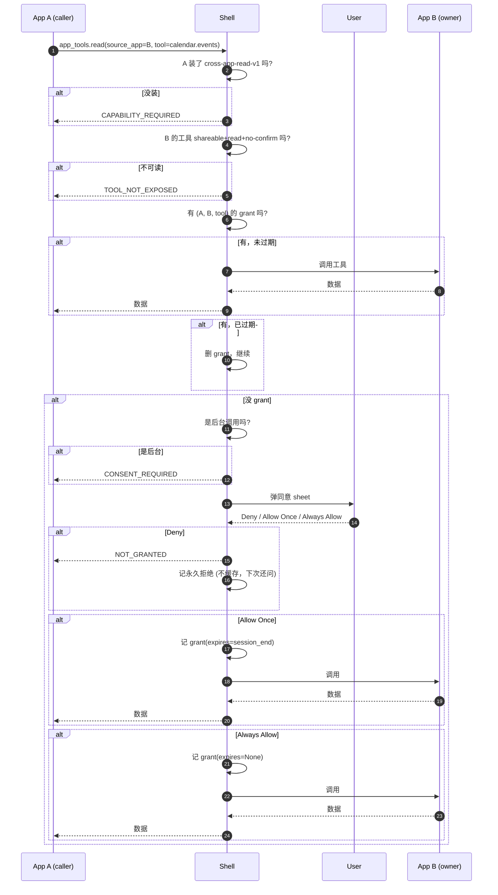

# Cross-app 读桥同意模型设计案（#532.3）

> Status: 设计阶段，**不写代码**。等你 review 通过后再 implement。

## 背景

PR #532 实现了 4 个 `app_tools.*` 宿主 API：
- `app_tools.read` — 读另一 app 的共享数据
- `app_tools.cancel` — 取消挂起的读
- `app_tools.focus` — 激活调用方自己的窗口
- `app_tools.watch_authorization` — 等待授权变化

当前的"同意"只有**两层隐式校验**：
1. 调用方 manifest 必须声明 `cross-app-read-v1` capability
2. 被读方工具必须标 `shareable=true + risk=read + no-confirm`

**缺一层用户显式同意**——A 装好之后**直接能读 B 的数据**，用户从来没机会说"我同意 A 读 B"。这跟手机 app 权限（相机/位置/通讯录）模式**完全不一样**。

## 借鉴的手机权限模型

| 模型 | 选项 | 颗粒度 | 触发时机 |
|---|---|---|---|
| **Android runtime** | Allow / Deny (+ Don't ask again 旧版) | app × permission | 第一次用 |
| **iOS Privacy** | Allow Once / Allow While Using / Don't Allow | app × permission | 第一次用 |
| **macOS TCC** | Don't Allow / Open System Settings | app × resource | 第一次用；拒绝后 30 天冷却 |
| **Chrome / Firefox 浏览器** | Allow / Block (per site) | site × permission | 第一次用 |
| **Twitter / Facebook data sharing** | Allow / Revoke (per app) | app × data type | 安装 + 第一次用 |

**共性**：
- 用户是**最终决定者**
- 选项是**三元组**（拒绝 / 一次性 / 总是）
- 第一次用才弹（不装时弹，太早）
- 设置里能 revoke
- 颗粒度 = app × 资源

## 我们的设计原则

1. **用户是最高权威**——即使 B 把数据标 `shareable: true`，A 也不能直接读，必须用户运行时同意
2. **双向同意**——A 声明意图（capability）+ B 声明开放（`shareable: true`）+ **用户授权（运行时 grant）** 三者都要
3. **三元选项**——Deny / Allow Once / Always Allow（跟 iOS 对齐）
4. **可 revoke**——设置里能撤销任何 grant
5. **第一次读才弹**——装时太早（A 还没决定读什么）
6. **失败要明显**——拒绝后 A 收到 `NOT_GRANTED`，不是默默失败

## 核心数据模型

```rust
// approvals/mod.rs (新增)
#[derive(Clone, PartialEq)]
struct PairGrant {
    caller: String,             // app id (e.g., "com.example.reader")
    owner: String,              // app id (e.g., "com.example.calendar")
    tool: String,                // tool name (e.g., "calendar.events")
    expires: Option<Instant>,   // None = 总是; Some = 一次性, 到点过期
    granted_at: Instant,
}

// 加到 Approvals struct 里
pair_grants: HashMap<(String, String, String), PairGrant>,
```

每个 grant 是 **(caller, owner, tool) → expiry** 的映射。

## Manifest 声明（已有 + 微调）

**调用方**（A）声明意图：
```json
{
  "schema": 1,
  "id": "com.example.reader",
  "capabilities": ["app_tools"],
  "requires": ["host-api-v1", "cross-app-read-v1"],
  "host_api": { "required": { "app_tools.read": 1 } }
}
```

**被读方**（B）声明开放：
```json
{
  "schema": 1,
  "id": "com.example.calendar",
  "tools": [
    { "name": "calendar.events", "risk": "read", "shareable": true },
    { "name": "calendar.add_event", "risk": "destructive", "shareable": false }
  ]
}
```

`shareable: true` 是 B **预先**声明"我愿意被跨 app 读"。这条**必须**在，**配合**运行时用户 grant，两层缺一不可。

## 运行时流程

### 流程图（Mermaid 渲染，ASCII 兜底）



### ASCII 兜底（聊天里看）

```
A → Shell: app_tools.read(B, calendar.events)
   ↓
Shell: A 装了 cross-app-read-v1?  ──N──> 返 CAPABILITY_REQUIRED
   ↓ Y
Shell: B 工具 shareable+read+no-confirm?  ──N──> 返 TOOL_NOT_EXPOSED
   ↓ Y
Shell: 有 grant (A, B, calendar.events)?
   ├── Y 未过期 → B → Shell → A
   ├── Y 已过期 → 删 grant, 走下面
   └── N → 是后台调用?
              ├── Y → 返 CONSENT_REQUIRED (让 A 引导用户去前台)
              └── N → 弹同意 sheet → 用户 3 选 1
                       ├── Deny ────────────────> NOT_GRANTED, 不缓存
                       ├── Allow Once ───────────> 记 grant (session 结束过期), 跑
                       └── Always Allow ─────────> 记 grant (永久), 跑
```

## UI 规格

### 同意 sheet（首次读时弹）

```
┌──────────────────────────────────────────────────────┐
│ 跨 app 数据访问请求                                    │
│                                                        │
│ Notes 想读你的 Calendar 事件                            │
│                                                        │
│   Notes (com.example.reader)                            │
│   装于 2026-09-15                                       │
│   想读：                                                │
│     • calendar.events (只读)                            │
│                                                        │
│ Calendar 数据所有者说：                                 │
│   "calendar.events" 标为可分享且只读。                 │
│                                                        │
│ [ 拒绝 ]    [ 一次性允许 ]    [ 总是允许 ]              │
│                                                        │
│   ⓘ 你可以在 设置 → 跨 app 数据共享 里改                 │
└──────────────────────────────────────────────────────┘
```

3 按钮，对应 iOS 的 "Don't Allow / Allow Once / Allow Always"。

### 设置页

`Settings → Privacy & Security → 跨 app 数据共享`

```
跨 app 数据共享
─────────────────────

允许这些 app 读你的数据：

✓  Notes → Calendar (calendar.events)
   授权于 2026-10-14                        [ 撤销 ]

✓  Todo → Contacts
   授权于 2026-09-20                        [ 撤销 ]

等待你决定：
⚠  News 想读 Weather                       [ 允许 ] [ 拒绝 ]

已永久拒绝：
✗  Reader → Mail                            [ 重新询问 ]
```

## 边界与边缘情况

| 情况 | 行为 |
|---|---|
| A 第一次读 B | 弹 sheet（前台）/ 返 `CONSENT_REQUIRED`（后台） |
| A 再读 B，刚才 "Allow Once" | 同一 session 内允许；session 结束过期 |
| A 再读 B，刚才 "Always Allow" | 直接允许，不弹 |
| A 读 B，grant 是 5 分钟前的 | 允许（永久 grant 不限时） |
| B 卸了 | A→B 的所有 grant 自动失效；A 读返 `OWNER_GONE` |
| A 卸了重装 | A 的所有 grant 失效（fresh start） |
| B 改 manifest 把 `shareable: true` 改 `false` | 数据 epoch 变更；A 下次读返 `TOOL_NOT_EXPOSED` |
| A 后台读 + 没 grant | 返 `CONSENT_REQUIRED`，A 应引导用户去前台 |
| 用户拒绝一次 | 返 `NOT_GRANTED`；**不**缓存，下次还问（用户可能改主意） |
| 用户拒绝 + A 1 小时内再问 | 仍然弹 sheet（不像 macOS 30 天冷却） |
| 嵌套读（A 读 B，B 读 C） | **不**支持——只追踪直接 A→B，间接忽略 |
| A 用 `app_tools.watch_authorization` 监听 B | grant 通过 watch 自动 revoke；user 撤销后 watch 收到变更 |

## 跟手机模式对比

| 维度 | 手机 | OctoSense |
|---|---|---|
| 选项数 | 2-3 | 3（Deny / Allow Once / Always Allow） |
| 触发 | 第一次用 | 第一次 read（不是 install） |
| 颗粒度 | app × 资源 | **A × B × tool**（更细） |
| 撤销 | 设置里能 | 设置里能 |
| 后台 | 静默拒绝 | 返 `CONSENT_REQUIRED`（不静默） |
| 永久拒绝 | macOS 30 天冷却 | **不冷却**（用户随时可改主意） |
| 自动撤销 | Android 几个月不用就撤销 | 不自动 |

## 跟当前 PR #532 边界

| 责任 | 当前 #532 | 这个设计新增 |
|---|---|---|
| 调用方声明 `cross-app-read-v1` | ✅ | （保留） |
| 被读方 `shareable: true` | ✅ | （保留） |
| 安装时 grant | ❌ | ✅（首次读时） |
| 3 选 1 sheet | ❌ | ✅ |
| 设置页 | ❌ | ✅（新加 `Settings → 跨 app 数据共享`） |
| 永久 grant 撤销 | ❌ | ✅ |
| 后台读失败码 | ❌ | ✅（`CONSENT_REQUIRED`） |

## 实现 outline

实现量（estimate）：
- 数据模型 + 查询/设置接口：~50 行
- `read_bridge` 流程加 grant 检查：~30 行
- 同意 sheet（sheet 类型 + 3 按钮逻辑）：~100 行 UI
- 设置页（跨 app 共享列表）：~50 行 UI
- 6-8 个测试：~200 行
- **合计 ~430 行**，分 1-2 个 commit

实现顺序：
1. **commit 1（数据层）**：加 `PairGrant` + `Approvals::pair_grants` 字段 + 查询/设置接口 + 4-5 个单元测试
2. **commit 2（运行时层）**：`read_bridge` 加 grant 检查；后台返 `CONSENT_REQUIRED`；新增 2-3 个集成测试
3. **commit 3（UI 层）**：同意 sheet + 设置页（最大、风险最大）

## 跟评审员的话怎么回

#532.3 的当前实现："PR body Risks 段注明"per-pair grant 是未来工作"。这个设计就是那个"未来工作"。

- 评审员 #532.3: "at minimum we need one of: a per-pair grant the person approves once, or an install-time disclosure"
- 我们的回应：**per-pair grant + install-time disclosure 都做**
- 评审员 #532.4: "wait for an actual 'tools mounted' signal, or avoid mounting UI for reads"
- 我们的回应：**避免挂起 owner UI**（已完成）+ **per-pair grant**（这个设计）

## 开放问题（请你决定）

1. **"Allow Once" 持续多久？**
   - A: shell 重启前有效（我推荐）
   - B: app A 关闭前有效
   - C: 1 小时

2. **永久拒绝冷却期？**
   - A: 不冷却，用户随时能改主意（我推荐——简单）
   - B: 像 macOS TCC 30 天冷却（防滥用）

3. **嵌套读 A→B→C？**
   - A: 不支持（v1 简化）。A 读 B 时只授权 A→B；B 读 C 是 B 自己的事，可能要 B 的用户 grant
   - B: 传递授权（更复杂）

4. **data owner 显式 consent sheet（B 主动同意）？**
   - A: 不做。`shareable: true` 就是 B 的"我已经同意被这样读"。运行时用户 grant 是**最终**一道
   - B: 做（更对称）

5. **公开/半公开数据"任何 cross-app-read 都能读"模式？**
   - 工具 manifest 可以声明 `"open": true`（不是 `shareable: true`）
   - 这种工具**自动** allow，不要 grant
   - 比如：Mail 的"已发送的邮件主题"对所有 app 公开
   - **不在 v1 范围**

请说每个的选项。

## v1 不在范围

- B 侧 consent sheet（B 主动同意每次读）
- 嵌套读授权传递
- 数据公开模式（`"open": true`）
- 自动撤销不用的 grant
- 读审计日志（"A 在何时读了你什么"，给 B 看的）
- 通知（A 读了 B 的数据时通知 B）
- 多人（多用户切换时 grant 怎么处理）
